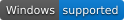
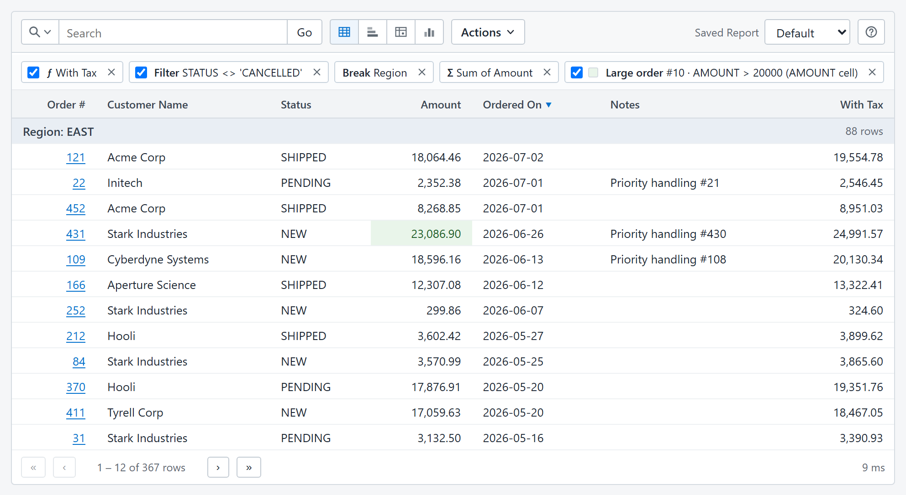

# AurorisNet.InteractiveReports

Oracle APEX-style interactive reports for ASP.NET Core. Define a report with a
`SELECT`; users can search, filter, sort, group, pivot, chart, highlight, and save
their view of the data.

**Start here for interactive reports in a browser.** This package supplies the
report viewer, administration pages, embeddable `<interactive-report>` element,
and REST API. The browser assets are included; your application needs no Node.js
installation or front-end build.

[](https://github.com/auroris/Interactive-Reports/blob/main/LICENSE)





[](https://interactive-report.pages.dev/)



**[Try the interactive demo](https://interactive-report.pages.dev/)**

## Install

In an ASP.NET Core application targeting .NET 8 or later:

```sh
dotnet add package AurorisNet.InteractiveReports
```

NuGet also installs `AurorisNet.InteractiveReports.AspNetCore` and
`AurorisNet.InteractiveReports.Core`. You do not need to add them separately.
Install the ADO.NET driver for your database in the host application: SQLite,
SQL Server, PostgreSQL, and Oracle are supported.

## How the packages fit together

| Package | Role | Installed with this package? |
|---|---|---|
| [AurorisNet.InteractiveReports.AspNetCore](https://www.nuget.org/packages/AurorisNet.InteractiveReports.AspNetCore/) | Server configuration, authorization, saved reports, and the shared execution boundary. | Yes |
| [AurorisNet.InteractiveReports.Core](https://www.nuget.org/packages/AurorisNet.InteractiveReports.Core/) | Report models, expression language, validation, SQL planning, and execution. | Yes |
| [AurorisNet.InteractiveReports.Client.FileDownload](https://www.nuget.org/packages/AurorisNet.InteractiveReports.Client.FileDownload/) | CSV and self-contained HTML download endpoints. Add this for browser downloads. | No; optional |
| [AurorisNet.InteractiveReports.Client.GraphQL](https://www.nuget.org/packages/AurorisNet.InteractiveReports.Client.GraphQL/) | Query saved reports through GraphQL.NET. Add this for GraphQL consumers. | No; optional |

If you only need server-side .NET integration, install the ASP.NET Core package
directly. If you only need GraphQL or download endpoints, install that adapter
directly; each includes the server and engine without the browser package.

## Get started

Configure a connection and report in `appsettings.json`, following the
[Getting started guide](https://github.com/auroris/Interactive-Reports/blob/main/docs/GETTING-STARTED.md).
Then register services and map the browser/API routes in `Program.cs`:

```csharp
using InteractiveReport.AspNetCore;
using InteractiveReport.Client.Json;

var builder = WebApplication.CreateBuilder(args);
builder.Services.AddInteractiveReports(builder.Configuration);
builder.Services.AddInteractiveReportJson();

var app = builder.Build();
app.MapInteractiveReportJson("/api/reports");
app.Run();
```

For a report named `orders`, open `/api/reports/orders/view`. The
[minimal sample](https://github.com/auroris/Interactive-Reports/blob/main/samples/Minimal/README.md)
includes a working SQLite database. Saved-report persistence and authentication
are configured by the host; see the getting-started guide for those steps.

NuGet IDs use `AurorisNet.InteractiveReports`; C# namespaces remain
`InteractiveReport.*`. Use matching versions when adding optional adapters.

## Documentation

- [Embedding and customizing the report](https://github.com/auroris/Interactive-Reports/blob/main/docs/EMBEDDING.md)
- [Saved reports and administration](https://github.com/auroris/Interactive-Reports/blob/main/docs/SAVED-REPORTS.md)
- [Authorization](https://github.com/auroris/Interactive-Reports/blob/main/docs/AUTHORIZATION.md)
- [User guide](https://github.com/auroris/Interactive-Reports/blob/main/docs/USER-GUIDE.md)
- [Source and issues](https://github.com/auroris/Interactive-Reports)
